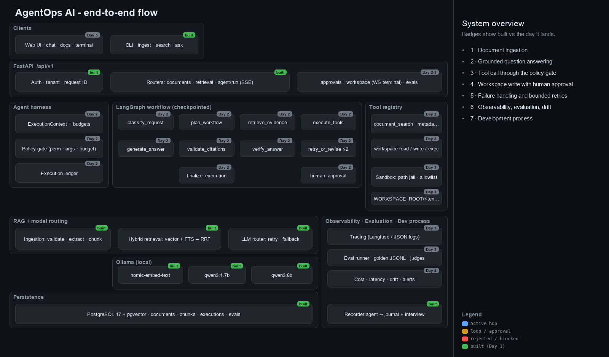

# AgentOps AI

A production-minded agentic RAG platform that runs fully on local, free models. It covers
ingestion, hybrid retrieval, grounded answers with validated citations, an execution harness that
enforces budgets and permissions in code, a custom agent loop, and a LangGraph workflow with
answer verification and human approval, sandboxed workspace tools (files + allowlisted commands,
writes gated by a human), traces exported to optional Langfuse/LangSmith, and an evaluation
framework with a 38-case golden dataset and a CI-style regression gate, measured cost/latency
optimizations behind a quality gate, drift monitoring with persisted alerts, per-tenant rate
limiting, a Docker image, and a React web UI that drives all of it through the public API.

- Product spec: [product.txt](product.txt) · Architecture: [docs/architecture/system-design.png](docs/architecture/system-design.png)
- Animated end-to-end flows: [docs/architecture/system-flow.gif](docs/architecture/system-flow.gif)
  (regenerate: `uv run --with pillow python docs/architecture/render_flow_gif.py`)
- Progress: [docs/day-checklist.md](docs/day-checklist.md) · Learning notes: [docs/journal/](docs/journal/) · Interview prep: [docs/interview/](docs/interview/)



Seven flows: ingestion, grounded Q&A, tool call through the policy gate, workspace write with human
approval, failure handling, observability/evaluation/drift, and the Recorder process. Badges
mark what is **built** versus the plan day that delivers it.

## Quick start

Prerequisites: Docker, [uv](https://docs.astral.sh/uv/), [Ollama](https://ollama.com) (`brew install ollama`).

```bash
ollama serve &                                   # if not already running
ollama pull qwen3:8b && ollama pull qwen3:1.7b && ollama pull nomic-embed-text

docker compose up -d db                          # PostgreSQL 17 + pgvector 0.8 on localhost:5433
uv sync                                          # install pinned dependencies (uv.lock)
uv run alembic upgrade head                      # create the schema

uv run agentops ingest datasets/corpus           # index the synthetic sample corpus
uv run agentops search "how long are transaction records kept"
uv run agentops ask "What is the RPO in v2 and how does it differ from v1?"
uv run agentops run "What is the RPO in the latest payments architecture, in seconds?" --trace
uv run agentops run "..." --mode loop            # the hand-written agent loop instead of the graph
uv run agentops run "Add a function minutes_to_seconds to calc/mathlib.py in my workspace"
uv run agentops approvals && uv run agentops approve <approval-id>   # the human in the loop
uv run agentops eval run --judge                 # 38 golden cases, JSON report under reports/
uv run agentops eval check reports/eval-<id>.json --baseline datasets/baselines/golden-v1-graph-qwen3-8b-day4.json
uv run agentops eval retrieval                   # retrieval-only metrics in seconds (no model)
uv run agentops experiment list                  # configuration profiles (datasets/experiments.json)
uv run agentops experiment run optimized --kind agent --judge --out reports/bench-optimized.json
uv run agentops experiment benchmark reports/bench-baseline.json reports/bench-optimized.json
uv run agentops drift check                      # quality/retrieval/data/operational; exit 1 on measured drift
uv run agentops metrics --hours 24               # latency, errors, retries, tokens, cost

uv run uvicorn --factory app.main:create_app --port 8000   # API + docs at http://localhost:8000/docs

cd web && npm install && npm run dev             # web UI at http://localhost:5173 (key: dev-key-tenant-a)
scripts/demo.sh                                  # the end-to-end demo through the API (APPROVE=1 to approve)
```

The full walkthrough (UI and API) is in [docs/demo.md](docs/demo.md).

In development, two API keys exist out of the box: `dev-key-tenant-a` and `dev-key-tenant-b`.
Set `AGENTOPS_API_KEYS` for anything else (see [.env.example](.env.example)); `AGENTOPS_ENV=prod`
refuses to start without explicit keys and database URL.

```bash
H='X-API-Key: dev-key-tenant-a'
curl -H "$H" -F file=@datasets/corpus/runbook-database-failover.md -F 'metadata={"team":"payments"}' \
     localhost:8000/api/v1/documents
curl -H "$H" -H 'content-type: application/json' localhost:8000/api/v1/rag/answer \
     -d '{"question": "Who is notified when authorization errors exceed 2%?"}'
curl -N -H "$H" -H 'content-type: application/json' localhost:8000/api/v1/agent/run/stream \
     -d '{"question": "What is the RTO in v2?", "mode": "graph", "limits": {"deadline_s": 120}}'
```

## API

| Method | Path | Purpose |
|---|---|---|
| GET | `/health`, `/ready` | Liveness; readiness checks DB, Ollama, and that configured models are installed |
| POST | `/api/v1/documents` | Upload TXT/MD/PDF (+ optional flat JSON `metadata`). 202 + background indexing; 200 if identical content exists |
| GET | `/api/v1/documents`, `/api/v1/documents/{id}` | List (paginated, `status` filter) / fetch |
| GET | `/api/v1/documents/{id}/chunks/{chunk_id}` | One source passage: what a citation points at (404 across tenants) |
| DELETE | `/api/v1/documents/{id}` | Delete document and its chunks |
| POST | `/api/v1/documents/{id}/reindex` | Re-chunk and re-embed with the current configuration |
| POST | `/api/v1/retrieval/search` | `vector` / `keyword` / `hybrid` search with per-result ranks and timing |
| POST | `/api/v1/rag/answer` | Non-agentic baseline: retrieve, answer, validate citations |
| POST | `/api/v1/llm/chat` | Direct bounded model call with usage, cost, latency, attempts |
| GET | `/api/v1/models` | Model per role and whether it is installed |
| POST | `/api/v1/agent/run` | Run the agent (`mode`: `graph` default, or `loop`); `limits` may only tighten server defaults |
| POST | `/api/v1/agent/run/stream` | Same, as Server-Sent Events: `start`, `step`, `model_call`, `tool_call`, `correction`, `approval`, `citation`, `final` |
| GET | `/api/v1/executions?limit=&status=` | The caller's most recent executions, newest first |
| GET | `/api/v1/executions/{id}` | Stored execution: status, answer, citations, counters, tokens, limits |
| GET | `/api/v1/executions/{id}/trace` | The execution ledger: every model call, tool call, rejection, and decision |
| GET | `/api/v1/approvals?status=pending` | Tool calls paused for a human decision |
| POST | `/api/v1/approvals/{id}/approve` · `/reject` | Decide once (409 afterwards); resumes the graph from its Postgres checkpoint |
| GET | `/api/v1/workspace/tree?path=` · `/file?path=` · `/search?q=` | Browse, read, and search the tenant's workspace (needs `workspace:read`) |
| PUT | `/api/v1/workspace/file` | User-initiated write; same path jail (needs `workspace:write`) |
| POST | `/api/v1/workspace/exec` | Allowlisted command, `argv` or a `line` (no shell); write/exec commands need `workspace:exec` |
| WS | `/api/v1/workspace/terminal` | JSON terminal protocol over the same executor (first frame `{"api_key": ...}`) |
| GET | `/api/v1/workspace/audit` | Every workspace operation by the agent or a user, including rejections |
| POST | `/api/v1/evaluations/run` | 202 + run id; runs a dataset from `datasets/` in the background (one at a time) |
| GET | `/api/v1/evaluations/runs` · `/runs/{id}` · `/compare?base=&head=` | Stored runs, per-case results, regression comparison |
| GET | `/api/v1/metrics?hours=24` | The caller's own operational metrics: success/timeout/failure rates, p50/p95, tokens, retries, cache hits, cost |
| GET | `/api/v1/monitoring/summary` · `/drift` · `/alerts` | Latest drift check, alert history, platform metrics |
| POST | `/api/v1/monitoring/check` | Run a drift check now and persist it with its alerts |
| GET · POST | `/api/v1/experiments` · `/experiments/run` | List profiles; run one (retrieval: 200 + report, agent: 202 + run id) |

Evaluation, experiment, and monitoring routes are operator-only (`AGENTOPS_ADMIN_TENANTS`, dev
default `tenant_a`); other tenants get 403. Every route that costs model time is rate limited
per tenant (429 + `Retry-After`).

Errors always look like `{"error": {"code", "message", "request_id"}}`; validation errors add
`details` with field locations only (submitted values are never echoed).

## How it works

```
upload ─► validate (size, extension, magic bytes, UTF-8) ─► extract (PDF pages kept as \f) ─► normalize
       ─► store (idempotent on tenant+sha256, versioned by filename) ─► 202
background ─► chunk (structured: paragraph/heading-aware, or fixed) ─► embed ("search_document:" prefix)
           ─► one transaction: replace chunks + mark READY + demote older versions   (else FAILED, 0 chunks)

query ─► embed ("search_query:") ─► pgvector HNSW cosine  ┐
      ─► websearch_to_tsquery (AND→OR, -negations as NOT) + ts_rank_cd       ┴► RRF (k=60) ─► dedupe ─► top-k
answer ─► evidence within char budget ─► fenced as untrusted <source id="S1"> blocks ─► qwen3:8b with
          JSON-schema constrained output ─► citations checked against retrieved IDs ─► ≤1 correction
```

Key decisions (details in [docs/journal/](docs/journal/)):

- **Tenant isolation in one place**: every retriever builds on `scoped_select`, which filters both
  the chunk and its document by tenant. Cross-tenant reads return 404, not 403.
- **Never silently partial**: chunks and the READY flag commit in one transaction.
- **RRF over score blending**: cosine similarity and `ts_rank_cd` live on incomparable scales.
- **No evidence, no model call**: cheaper and cannot hallucinate. It fires for empty tenants,
  filters matching nothing, and (only if `AGENTOPS_RETRIEVAL_MIN_VECTOR_SCORE` is set) when every
  vector hit is below the floor; otherwise the model itself must report `insufficient_evidence`.
  The floor is off by default because it was measured, not guessed: unanswerable questions reach
  a top cosine of 0.766 while answerable ones go as low as 0.651, so no single value separates them.
- **Fallback only for availability**: retries and the optional hosted fallback trigger on
  transient errors only (connect/timeout/5xx/429), never on bad output.

### Agents

```
request ─► ExecutionContext (tenant, limits, allowed tools, permissions, ledger)
        ─► Harness gate before EVERY model/tool call: cancelled? ─► deadline? ─► budget? ─► permitted? ─► valid args?
graph:   classify ─► plan (queries) ─► retrieve ─► [tools ⇄ human_approval] ─► generate ─► validate citations
         ─► verify (entailment, qwen3:8b) ─► finalize        bounded retry_or_revise ─► generate
loop:    model ⇄ tools until final_answer (≤8 steps); repeated identical calls are refused
```

- **Policy in code, not prompts**: limits, permissions, approvals, and timeouts are enforced by
  [app/agents/harness.py](app/agents/harness.py); a request can tighten limits, never loosen them.
- **FINAL or TOOL_CALLS, never prose**: the loop ends only through a `final_answer` tool call (or
  schema-valid JSON); text is never parsed as an instruction.
- **Untrusted evidence**: passages and tool results are fenced and escaped; citations must name
  IDs actually shown to the model; the graph also checks that cited text supports the answer.
- **Pause and resume**: write tools stop at `human_approval` (LangGraph `interrupt`); the paused
  state, including budget counters, lives in Postgres, so approval works after a restart.
- **When to use which**: `/rag/answer` for plain lookups (one call, cheapest); the loop when the
  number and order of tool calls is open; the graph when steps must happen in a fixed order, a
  run must pause for a human, or each step needs its own model and test. See
  [app/agents/graph.py](app/agents/graph.py).

### Workspace (sandboxed files + commands)

Each tenant gets `AGENTOPS_WORKSPACE_ROOT/<tenant>/` (default `./workspace/`, gitignored; dev
grants `tenant_a`, set `AGENTOPS_WORKSPACE_TENANTS` otherwise). Enforced in
[app/workspace/](app/workspace/), never in prompts:

- **Path jail**: relative paths only, no `..`, realpath before the containment check (symlinks
  pointing outside are refused), plus a deny-list (`.env*`, `*.pem`, `*.key`, `id_rsa*`, `.ssh/`,
  `.git/config`; nothing under `.git/` is writable).
- **Commands**: argv only (no shell, pipes, globbing, substitution), a per-command option
  allowlist (`find -exec`, `grep -f`, `git diff --output` are refused), path arguments go through
  the jail, a scrubbed environment (no API keys), a timeout that kills the process group, and an
  output cap. Read-only: `ls cat head tail wc grep find`, `git status/diff/log`. Need approval:
  `python -m pytest`, `pytest` (collection runs code), `git add`, `mkdir`.
- **Writes** (`workspace_write`, `workspace_edit`) always pause at `human_approval`; approved
  writes carry an idempotency receipt, and repeating the last side-effecting call is refused.
- **Not an OS sandbox**: an approved `pytest` runs workspace code with the server's privileges.
  The approval is the control; production would add a container or VM.

### Observability

Traces are built from the execution ledger after each run ([app/observability/](app/observability/)):
one trace per execution (id = execution id), a span per graph node or loop turn, a generation per
model call (model, tokens, latency), a span per tool call with retrieval child spans (embedding,
vector, keyword), and events for rejections, approvals, corrections, and the final decision.
Export is fire-and-forget with a timeout, so a backend outage never affects a run.

- Always on: one structured `trace` log line per execution.
- Langfuse: set `AGENTOPS_LANGFUSE_PUBLIC_KEY` / `_SECRET_KEY` (`_HOST` for self-hosted).
- LangSmith: set `AGENTOPS_LANGSMITH_API_KEY`; by default (`AGENTOPS_LANGSMITH_SCOPE=eval`) only
  evaluation runs and their scores go there, so both tools can be compared on the same subset.
- Both adapters are tested against mocked HTTP only; no live Langfuse/LangSmith project was used.

### Evaluation

`datasets/golden_questions.jsonl` (golden-v1, 38 cases: answerable, multi-document,
unanswerable, tool use, adversarial incl. a prompt-injection document, workspace) runs through the
real agent as the `eval` tenant. Deterministic evaluators decide pass/fail: expected status,
citation validity, required sources retrieved and cited, structured-output validity, tool
arguments/results, forbidden tools never run or approved, approval requested, step limit, answer
must/must-not contain, workspace effects. `--judge` adds advisory LLM scores (correctness,
groundedness, relevance, completeness) that never decide pass/fail. Runs are stored in Postgres
with dataset hash, models, prompt/workflow versions, and retrieval config.
`agentops eval check` / `compare` exit 1 when [datasets/eval_thresholds.json](datasets/eval_thresholds.json)
is breached (pass-rate floor and drop, per-category and per-evaluator drops, zero tolerance for
`unauthorized_tools` and `workspace_effects`, p95 latency).

### Optimization (Day 4)

Every switch is a setting, off by default, and grouped into profiles in
[datasets/experiments.json](datasets/experiments.json). A profile is accepted only if
`agentops experiment benchmark` shows a >5% gain in latency, tokens, or model calls **and** no
quality breach against the baseline (same thresholds as the eval gate). Results:
[docs/benchmarks/day4.md](docs/benchmarks/day4.md). The server defaults stay at the baseline so
every benchmark measures one switch at a time; to run the accepted `optimized` profile, set
`AGENTOPS_AGENT_RULE_ROUTING=true`, `AGENTOPS_CACHE_QUERY_EMBEDDINGS=true`, and
`AGENTOPS_CACHE_TOOL_RESULTS=true`.

The custom loop and the LangGraph workflow are compared on the same cases in
[docs/benchmarks/loop-vs-graph.md](docs/benchmarks/loop-vs-graph.md).

- **Rule routing** (`AGENTOPS_AGENT_RULE_ROUTING`): plain lookups skip the tool-selection model
  call; questions that ask for a calculation get a calculator nudge instead.
- **Caches** (in-process LRU + TTL): query embeddings keyed by (tenant, model, query); read-only
  tool results keyed by tool, tenant, permissions, arguments, the tenant's corpus version (count +
  last update, read from the DB), and the retriever config, so an upload or config change can never
  serve stale evidence. Optional semantic answer cache (cosine ≥ 0.97) for verified, read-only
  graph answers, scoped the same way; off by default.
- **Evidence cap**, `search_top_k`, **small-model drafts** for simple lookups, and query rewrite
  on/off are further switches. Turning query rewrite off was measured and rejected: the raw
  question ("RPO") does not retrieve the "Availability and Recovery" passages; the rewrite does.
- **Usage accounting** per run and per eval case: model calls by model, failed calls, retries,
  embedding calls, cache hits, tokens. Local cost is $0; a hosted-equivalent cost appears only when
  reference prices are configured and is labelled hypothetical.

### Drift monitoring

`agentops drift check` / `POST /api/v1/monitoring/check` compare the current state with committed
baselines ([datasets/baselines/](datasets/baselines/)) using
[datasets/drift_thresholds.json](datasets/drift_thresholds.json), and persist the check and one
alert per breached signal. Each signal is `ok`, `drift`, or `insufficient_data` (too few samples
is never reported as healthy), with evidence `measured` or `suspected` and a severity.

- **Quality**: pass rate, per category, zero-tolerance evaluators, judge score (suspected only).
- **Retrieval** (deterministic, no model): hit@k, recall@k, MRR, answer coverage@k (are the
  answer strings in retrieved passages *from the expected documents*), source-distribution shift
  (total variation distance); messages name the config fields that changed.
- **Data**: ingestion failure rate, a tenant corpus mixing embedding models (critical) or chunking
  configs, corpus size change, golden dataset changed.
- **Operational** (current vs previous window): p95 latency, timeout/failure/provider-error/retry
  rates, tokens per execution.

Demo: the `degraded-chunking` profile (250-char fixed chunks, vector only) is flagged with measured
drift on pass rate and answer coverage; file-level recall and hit rate stay at 1.0 on this corpus,
which is why answer coverage exists.

### Hardening

- Per-tenant token-bucket rate limits per route class (`agent`, `upload`, `expensive`,
  `workspace`), configurable via `AGENTOPS_RATE_LIMIT_*`; 429 with `Retry-After`.
- Operator-only evaluation, experiment, and monitoring APIs; profiles can override only an
  allowlisted set of settings, and a profile that changes chunking must use its own eval tenant.
- `Dockerfile`: non-root, `uv sync --frozen --no-dev`, healthcheck, migrations on start.
  `docker compose --profile app up -d` runs the API against Ollama on the host
  (`AGENTOPS_OLLAMA_BASE_URL_FROM_DOCKER`, default `http://host.docker.internal:11434`). Ollama
  must listen beyond loopback for that (`OLLAMA_HOST=0.0.0.0:11434 ollama serve`); otherwise
  `/ready` reports `ollama: unreachable` while the database check passes.

## Web UI

React + TypeScript + Vite + Tailwind in [web/](web/), with no other runtime dependencies. It is
a pure client of the public API: every rule (permissions, approvals, limits, tenant isolation)
is enforced by the server, and the only credential the UI holds is the user's API key (browser
local storage). In development and `npm run preview`, Vite forwards `/api` (including the
terminal WebSocket) to the API (`AGENTOPS_API_URL`, default `http://localhost:8000`), so the
backend needs no CORS configuration.

| Screen | What it shows |
|---|---|
| Chat | Streams the run over SSE: each step, model call, tool call, and approval as it happens; the answer with clickable `[S1]`/`[T1]` citations that open the source passage or tool result; graph or loop mode |
| Documents | Upload (with optional metadata), status while indexing, reindex, delete |
| Workspace | File tree, viewer/editor (your own writes), a terminal over the same sandboxed executor (refusals shown in red), and the audit log |
| Approvals | Pending writes and commands with a diff preview against the current file; approve or reject with a reason; the resumed run's answer |
| Executions | Recent runs and a per-run timeline from the ledger: steps, model and tool calls, latency bars, tokens, cache hits |
| Evaluations & Monitoring | Operator only: runs, per-category and per-evaluator scores, failing cases, baseline comparison with the regression gate, drift status with signals, alerts, and "run check now" |

```bash
cd web
npm run dev          # http://localhost:5173
npm test             # unit tests (SSE parser, diff, citation parsing)
npm run typecheck && npm run build
AGENTOPS_API_URL=http://localhost:8010 npm run dev   # API on another port
```

## Development

```bash
uv run pytest                 # unit + integration (needs `docker compose up -d db`; uses agentops_test DB)
uv run pytest -m live         # opt-in checks against the real Ollama models
uv run ruff check app tests && uv run ruff format --check app tests && uv run mypy app
```

Integration tests create `agentops_test`, run Alembic `downgrade base` + `upgrade head`, and
use a deterministic fake embedder and fake LLM. CI (`.github/workflows/ci.yml`) runs the same
suite with a pgvector service container and fails if the database is missing.

## Models

Chosen for an Apple M4 with 16 GB (see product.txt §23): `qwen3:8b` (answers, tools), `qwen3:1.7b`
(classification/routing), `nomic-embed-text` (768-d). Measured on this machine: qwen3:8b ≈ 16
tok/s, qwen3:1.7b ≈ 52 tok/s; a grounded answer takes ~6–17 s. Cost for local models is
reported as `0` with `pricing_source: "local"`; hosted models without a configured price report
`null` / `"unavailable"`, never a guess.

## Troubleshooting

- `/ready` returns `ollama: unreachable` → run `ollama serve`; `missing_models` → `ollama pull <name>`.
- Integration tests skipped → start the database: `docker compose up -d db`.
- Port 5433 in use → `AGENTOPS_DB_PORT=5435 docker compose up -d db`, then point
  `AGENTOPS_DATABASE_URL` (and for tests `AGENTOPS_TEST_ADMIN_DSN` / `AGENTOPS_TEST_DATABASE_URL`) at 5435.
- Agent runs much slower than the timings above → check memory (`sysctl vm.swapusage`,
  `ollama ps`). On 16 GB, other containers plus qwen3:8b at an 8k context cause heavy swapping.
- Port 8000 in use (another project's server) → run the API with `--port 8010` and start the UI
  with `AGENTOPS_API_URL=http://localhost:8010 npm run dev`; for the demo, `AGENTOPS_URL=http://localhost:8010`.
- A run fails with `provider_unavailable` in the middle (`ollama ps` shows nothing, the Ollama
  process is gone) → under heavy memory pressure macOS can kill Ollama; restart `ollama serve`.
- Every model call fails with `provider_error` but `/api/tags` answers → another Ollama (e.g. a
  container from another project) owns port 11434 without these models. Run a second one,
  `OLLAMA_HOST=127.0.0.1:11435 ollama serve`, and set `AGENTOPS_OLLAMA_BASE_URL=http://localhost:11435`.

## Known limitations

- Background indexing uses FastAPI `BackgroundTasks` (in-process): a crash mid-indexing leaves the
  document `processing`. A durable queue is a later hardening step.
- The vector relevance floor is off by default (see above); weak nearest neighbours still reach
  the model, which must then report `insufficient_evidence` itself.
- Scanned PDFs (no text layer) are rejected; there is no OCR.
- Changing the embedding model's dimension needs a migration and a full reindex.
- Web UI: no login of its own (the API key is the credential, kept in browser local storage);
  one terminal command at a time (not a PTY); the approval preview diffs against the file's
  first 20 KB when it is larger; no mobile layout.
- An evaluation run whose process is killed (e.g. the machine sleeps) stays `running` in the
  database; only a graceful cancel marks it failed.
- The drift check's default "current" retrieval report is simply the latest one, which can be an
  experiment probe (e.g. `degraded-chunking`); pass the reports explicitly for a clean comparison.
- Rate limits and caches are in-process: with several API replicas each has its own buckets and
  caches (Redis would be the next step). The workspace WebSocket terminal is not rate limited.
- Indexing is fail-closed: a document is unsearchable while reindexing, a failed reindex drops its
  previous chunks, and deleting the latest version does not re-promote the previous one.
- Re-uploading an older version's exact bytes returns that document as a duplicate; it does not
  become latest again (call reindex). The same applies to a FAILED document's bytes.
- Agent latency on the M4 is 30–90 s per graph run (more under memory pressure). See
  [docs/benchmarks/day4.md](docs/benchmarks/day4.md) for what routing and caching changed.
- The loop's answers are grounded but sometimes incomplete (it answered "5 minutes" without the
  requested seconds conversion in 2 of 4 live runs). The Day 3 evaluation set measures this.
- A pending approval is resumed through the API or `agentops approve`; there is no expiry or
  notification yet.
- Workspace: not an OS sandbox (see above); permissions are all-or-nothing per tenant; receipts
  are never cleaned up; the terminal is one command at a time, not a PTY.
- After a failed first attempt and a successful retry, qwen3:8b sometimes reports the workspace
  action as failed (caught by the `ws-edit-approved` eval case); still open.
- LLM-judge scores come from the same local model family that wrote the answers: advisory only.
- Live results (golden-v1, graph, qwen3:8b): baseline 33/38 (87%), `optimized` 36/38 (95%; tool
  use 2/5 → 5/5). Still failing: `multi-retention` and `ws-edit-approved`.
- Tokens spent on failed model calls and on router-internal retries are not counted against the
  token budget (the harness counts calls when attempted, but tokens only from successful replies).
